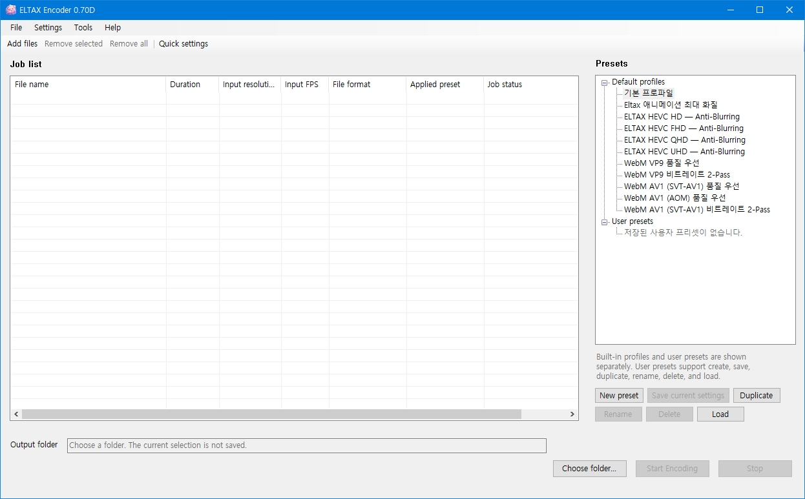
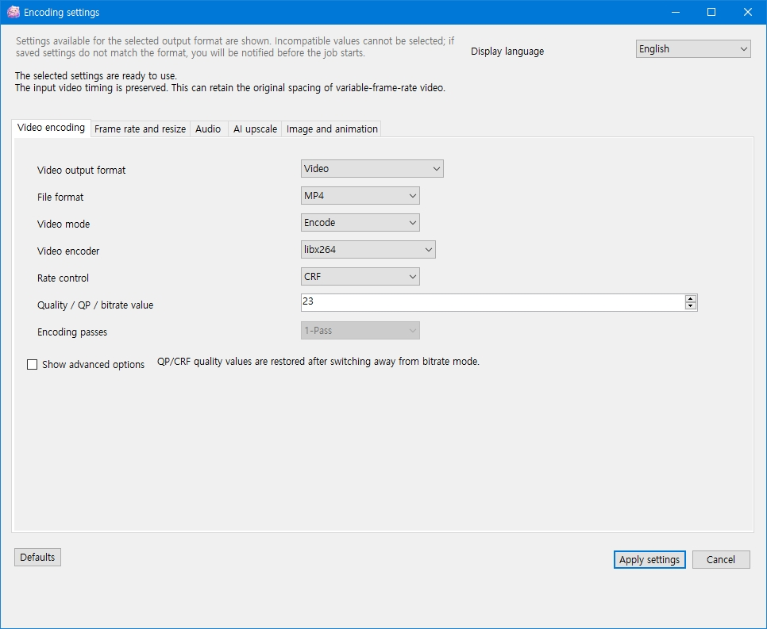
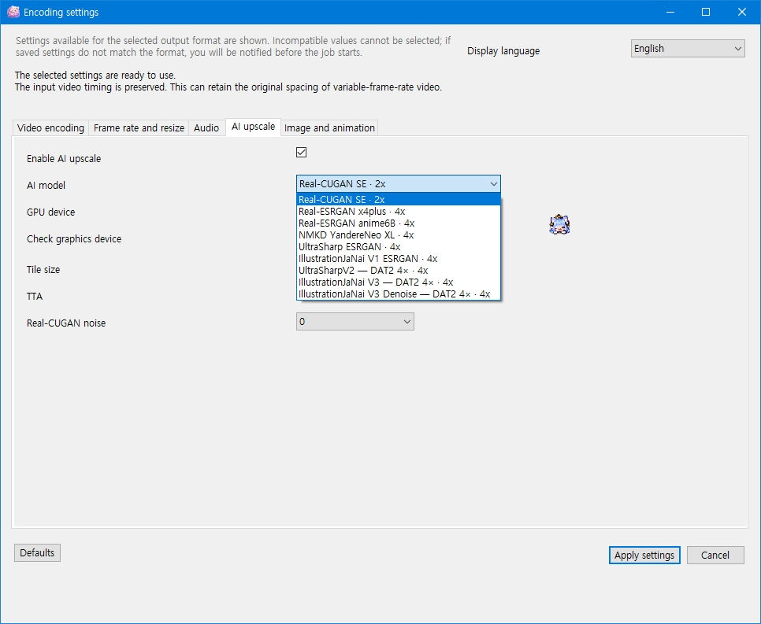
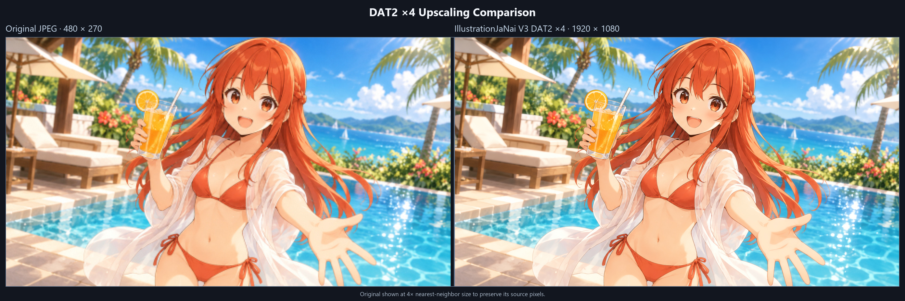
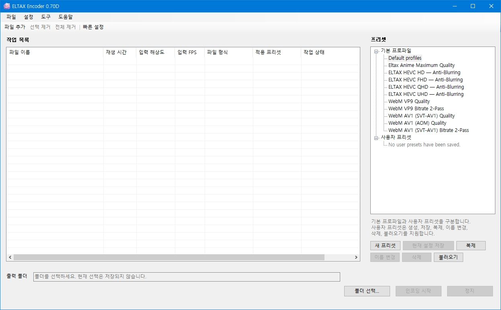
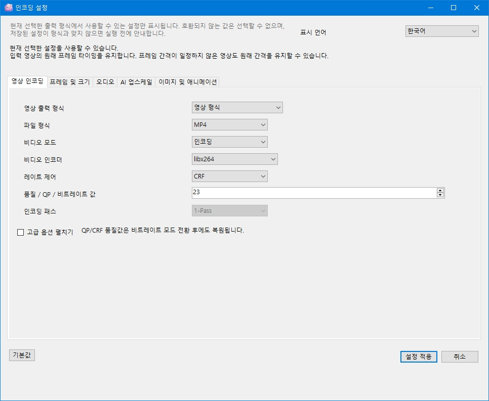
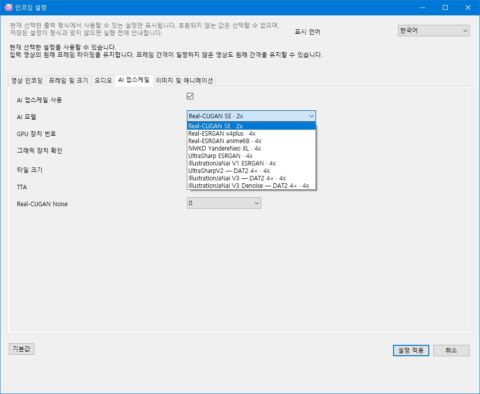

# ELTAX Encoder

**English | [한국어](#한국어)**

**Current release: v0.70D**

**ELTAX Encoder** is a portable Windows media processing utility built around **AI image and video upscaling**.

Rather than treating AI upscaling as an optional feature added to an encoder, ELTAX Encoder uses a shared AI processing pipeline that can be applied to video, still images, and animated image formats before the final output is encoded or written.

AI upscaling can be turned **ON or OFF** independently from the selected output codec or format.

> **Portable application**
>
> No installer is required.  
> Extract the entire package and run `EltaxEncoder.exe`.

### What's new in v0.70D

- Added manual **Korean / English** language selection from **Settings → Language**.
- The selected language is saved and reused on the next launch.
- Restored **Quick Settings** so it can be opened even before any files are added.
- Quick Settings can be prepared in advance and continues to work with the existing batch/list-wide workflow.
- Corrected version metadata consistency for the native launcher.

---

## Screenshots

### Main Window



### Encoding Settings



### AI Upscaling



### AI Upscaling Sample



---

## Features

- AI upscaling for **video, images, and animated images**
- AI processing can be enabled or disabled independently of the output format
- Shared AI processing pipeline across supported media types
- Multiple NCNN / Vulkan and DAT2 AI upscaling models
- Final output resolution can be controlled independently from the native scale of the selected AI model
- Batch processing
- Video and image/animation batch families
- Drag & drop file input
- Quick Settings available before adding files and applicable across the current job list
- Reusable encoding profiles
- Source timing / VFR preservation
- Optional custom output frame rate
- Multiple video codecs and containers
- Still-image output
- Animated GIF / APNG / Animated WebP output
- Portable data storage
- Korean and English language packs with manual language selection
- Built-in categorized Help
- Third-party component and model license information available from **About**

---

## AI Upscaling

ELTAX Encoder includes several AI upscaling backends and models.

### Real-CUGAN

- **Real-CUGAN SE 2×**
- Multiple denoise levels
- NCNN / Vulkan runtime

### Real-ESRGAN / ESRGAN

- **Real-ESRGAN x4plus**
- **Real-ESRGAN anime6B**
- **NMKD YandereNeo XL**
- **UltraSharp ESRGAN**
- **IllustrationJaNai V1 ESRGAN**

### DAT2

- **UltraSharpV2 DAT2 4×**
- **IllustrationJaNai V3 Detail DAT2 4×**
- **IllustrationJaNai V3 Denoise DAT2 4×**

DAT2 models use ELTAX Encoder's native DAT2 worker and Vulkan backend.

---

## AI Scale and Output Resolution

The AI model's native scale and the final output resolution are separate settings.

For example:

```text
Input
1280 × 720

        ↓

AI model
4× upscale

        ↓

AI processing resolution
5120 × 2880

        ↓

Final output resize
1920 × 1080

        ↓

Encoded output
1920 × 1080
```

If final output resizing is disabled, the AI model's native upscale resolution becomes the output resolution.

This allows a high-resolution AI pass to be performed before resizing to the desired delivery resolution.

---

## Supported Video Codecs

Depending on the selected encoding mode and hardware environment, ELTAX Encoder supports:

- **H.264 / AVC**
  - libx264
  - AMD AMF
- **H.265 / HEVC**
  - libx265
  - AMD AMF
- **VP9**
  - libvpx-vp9
- **AV1**
  - SVT-AV1
  - libaom-av1
- **Xvid**
  - libxvid

---

## Supported Containers

- MP4
- MKV
- WebM
- AVI

Container availability depends on the selected codec.

---

## Audio Encoding

Available audio encoding paths include:

- AAC
- MP3
- Opus
- Vorbis
- PCM

Available combinations depend on the selected output container.

---

## Image Output

Supported still-image output formats include:

- JPEG
- PNG
- WebP
- AVIF
- BMP
- TIFF

AI upscaling can be applied before the final image is written.

---

## Animated Image Output

Supported animated output formats include:

- GIF
- APNG
- Animated WebP

AI processing is performed on the decoded frames before final output scaling and animation encoding.

Source presentation timing is preserved when using source timing.

---

## Batch Processing

Multiple files can be added to a single job list.

A job list uses one media family:

### Image / Animation

Examples:

- PNG
- JPEG
- WebP
- GIF
- APNG
- Animated WebP

### Video

Examples:

- MP4
- MKV
- WebM
- AVI

The first accepted file determines the media family for that job list.

Files from incompatible media families are not silently mixed into the same batch.

---

## Profiles

Encoding and processing settings can be saved as reusable profiles.

Profiles can contain settings such as:

- Output format
- Video codec
- Audio codec
- AI model
- Output resolution
- Resize mode
- Frame-rate settings
- Codec-specific settings

Profiles can be selected again for future jobs.

---

## Resize Modes

When a final output resolution is specified, ELTAX Encoder supports multiple resize behaviors.

### Fit

Fits the source inside the target resolution while preserving its aspect ratio.

### Fill

Fills the target canvas while preserving the aspect ratio. Cropping may occur.

### Stretch

Resizes directly to the requested dimensions without preserving the original aspect ratio.

---

## Timing

By default, ELTAX Encoder preserves the source presentation timeline.

When **Custom FPS** is not enabled:

- Source timing is preserved
- Variable frame rate input can retain its presentation timing
- AI upscaling changes spatial image data, not the intended source timeline

A custom output frame rate can be selected when frame-rate conversion is desired.

---

## Download and Run

Download the latest release from:

https://github.com/laikal/Eltax-Encoder/releases

Download:

`eltax-encoder-win-x64-0.70D.zip`

Extract the **entire ZIP** to a folder and run:

`EltaxEncoder.exe`

Do not run the application directly from inside the ZIP archive.

No installer is required.

---

## Portable Data

ELTAX Encoder is designed as a portable application.

Program data, configuration, temporary working data, and other application-managed files are kept within the portable deployment structure rather than silently depending on a separate installed application environment.

For normal use, keep the distributed directory structure intact.

---

## FFmpeg

ELTAX Encoder uses **FFmpeg 9.0.2** for media decoding, encoding, probing, filtering, and container processing.

The distributed FFmpeg build is based on the Gyan FFmpeg Full build.

FFmpeg is executed as an external media-processing component.

FFmpeg and its bundled third-party libraries retain their respective licenses.

See:

**About → Third-party Components & Licenses**

and the distributed:

`Licenses\`

directory for additional information.

---

## AI Model Licenses

AI models bundled with ELTAX Encoder remain subject to the terms specified by their original creators and distributors.

Some bundled models use Creative Commons licenses including:

- CC BY-NC 4.0
- CC BY-NC-SA 4.0

Model source, attribution, license information, and conversion notices are available from:

**About → Third-party Components & Licenses**

and the distributed:

`Licenses\`

directory.

ELTAX Encoder does not claim ownership of third-party AI models.

---

## Help

ELTAX Encoder includes a built-in Help window covering topics such as:

- Quick start
- File input
- Batch processing
- Profiles
- AI upscaling
- AI model scale
- Output resolution
- Resize modes
- Video encoding
- Image output
- Animated image output
- Frame-rate behavior
- Troubleshooting
- Portable operation

Press **F1** or open Help from the application menu.

---

## System Requirements

- 64-bit Windows 10 or Windows 11
- x64 processor
- Sufficient free disk space for source media, temporary processing data, and output files
- Vulkan-capable GPU and compatible graphics driver for AI upscaling

AI processing performance depends heavily on the selected model, input resolution, GPU, and available VRAM.

CPU-based video encoding performance depends on the selected codec and system processor.

---

## Package Size

ELTAX Encoder includes:

- Multiple AI model weights
- NCNN / Vulkan AI runtimes
- DAT2 runtime and model archives
- FFmpeg / FFprobe
- Self-contained .NET runtime
- Language and Help resources

Because these components are bundled for portable use, the extracted package is larger than a typical encoder-only application.

---

## Languages

Included language packs:

- English
- 한국어

The language can be changed manually from **Settings → Language**.  
If no language has been selected manually, ELTAX Encoder uses its existing automatic language detection and falls back to English when needed.

---

## Developer

**Eltax**

---

## Disclaimer

ELTAX Encoder is provided as an independent media-processing utility.

Third-party project names, model names, codecs, trademarks, and software components belong to their respective owners.

Output quality, processing speed, hardware acceleration availability, and AI-model behavior may vary depending on the input media, selected settings, hardware, drivers, and third-party runtime components.

Always keep important original media backed up.

---

## License

No open-source license is currently provided for the ELTAX Encoder project source code.

**Copyright © Eltax. All rights reserved.**

Bundled third-party software, libraries, runtimes, and AI models retain their respective licenses and rights.

Applicable attribution, license texts, source information, and model notices are available from:

**About → Third-party Components & Licenses**

and the distributed:

`Licenses\`

directory.

---

# 한국어

**[English](#eltax-encoder) | 한국어**

**현재 버전: v0.70D**

**ELTAX Encoder**는 **AI 이미지·영상 업스케일링을 중심으로 설계된 Windows 포터블 미디어 처리 프로그램**입니다.

단순히 인코더에 AI 업스케일 기능을 추가한 구조가 아니라, 영상·이미지·애니메이션 이미지가 공통 AI 처리 경로를 사용할 수 있도록 구성되어 있습니다.

AI 업스케일은 출력 코덱이나 형식과 별개로 사용자가 직접 **ON / OFF**할 수 있습니다.

> **포터블 프로그램**
>
> 별도의 설치 프로그램은 필요하지 않습니다.  
> ZIP 전체를 압축 해제한 뒤 `EltaxEncoder.exe`를 실행하면 됩니다.

### v0.70D 주요 변경 사항

- **설정 → 언어**에서 한국어 / English를 사용자가 직접 선택할 수 있도록 추가
- 선택한 언어를 저장하고 다음 실행에서도 유지
- 파일을 추가하기 전에도 **빠른 설정** 창을 열 수 있도록 기존 동작 복구
- 빠른 설정의 기존 일괄/목록 전체 적용 동작 유지
- Native Launcher의 버전 메타데이터 정합성 수정

---

## 스크린샷

### 메인 화면



### 인코딩 설정



### AI 업스케일




### AI 업스케일 샘플


---

## 주요 기능

- **영상 / 이미지 / 애니메이션 이미지 AI 업스케일**
- 출력 형식과 별도로 AI 처리 ON / OFF 가능
- 지원 미디어에서 공통 AI 처리 경로 사용
- 여러 NCNN / Vulkan 및 DAT2 AI 업스케일 모델 제공
- AI 모델 자체 배율과 최종 출력 해상도를 별도로 설정 가능
- 여러 파일 일괄 처리
- 영상 / 이미지·애니메이션 배치 분리
- 파일 Drag & Drop
- 파일 추가 전에도 열 수 있으며 현재 작업 목록 전체에 적용할 수 있는 빠른 설정
- 인코딩 설정 프로파일 저장 및 재사용
- Source Timing / VFR 보존
- 사용자 지정 출력 FPS
- 여러 영상 코덱 및 컨테이너 지원
- 이미지 출력
- GIF / APNG / Animated WebP 출력
- 포터블 데이터 구조
- 한국어 / 영어 언어팩 및 사용자 직접 언어 선택
- 항목별 내장 도움말
- **프로그램 정보 → Third-party Components & Licenses**에서 제3자 구성 요소와 AI 모델 라이선스 확인

---

## AI 업스케일

ELTAX Encoder에는 여러 AI 업스케일 엔진과 모델이 포함되어 있습니다.

### Real-CUGAN

- **Real-CUGAN SE 2×**
- 여러 노이즈 제거 단계
- NCNN / Vulkan 기반

### Real-ESRGAN / ESRGAN

- **Real-ESRGAN x4plus**
- **Real-ESRGAN anime6B**
- **NMKD YandereNeo XL**
- **UltraSharp ESRGAN**
- **IllustrationJaNai V1 ESRGAN**

### DAT2

- **UltraSharpV2 DAT2 4×**
- **IllustrationJaNai V3 Detail DAT2 4×**
- **IllustrationJaNai V3 Denoise DAT2 4×**

DAT2 모델은 ELTAX Encoder의 네이티브 DAT2 worker와 Vulkan backend를 사용합니다.

---

## AI 배율과 출력 해상도

AI 모델의 처리 배율과 최종 파일의 출력 해상도는 서로 다른 설정입니다.

예를 들어:

```text
입력
1280 × 720

        ↓

AI 모델
4× 업스케일

        ↓

AI 처리 해상도
5120 × 2880

        ↓

최종 출력 리사이즈
1920 × 1080

        ↓

최종 파일
1920 × 1080
```

최종 출력 리사이즈를 사용하지 않으면 AI 모델의 기본 업스케일 해상도가 그대로 최종 출력 해상도가 됩니다.

따라서 높은 해상도에서 AI 처리를 먼저 수행한 뒤 원하는 최종 해상도로 줄여서 저장하는 방식도 사용할 수 있습니다.

---

## 지원 영상 코덱

선택한 인코딩 방식과 시스템 환경에 따라 다음 영상 코덱을 사용할 수 있습니다.

- **H.264 / AVC**
  - libx264
  - AMD AMF
- **H.265 / HEVC**
  - libx265
  - AMD AMF
- **VP9**
  - libvpx-vp9
- **AV1**
  - SVT-AV1
  - libaom-av1
- **Xvid**
  - libxvid

---

## 지원 컨테이너

- MP4
- MKV
- WebM
- AVI

사용 가능한 조합은 선택한 영상·오디오 코덱에 따라 달라질 수 있습니다.

---

## 오디오 인코딩

지원되는 오디오 인코딩 경로에는 다음이 포함됩니다.

- AAC
- MP3
- Opus
- Vorbis
- PCM

사용 가능한 조합은 선택한 출력 컨테이너에 따라 달라질 수 있습니다.

---

## 이미지 출력

지원 이미지 형식:

- JPEG
- PNG
- WebP
- AVIF
- BMP
- TIFF

필요한 경우 AI 업스케일을 수행한 뒤 최종 이미지를 저장할 수 있습니다.

---

## 애니메이션 이미지 출력

지원 형식:

- GIF
- APNG
- Animated WebP

AI 처리를 사용하는 경우 디코딩된 각 프레임에 업스케일 처리를 수행한 뒤 최종 출력 크기와 애니메이션 형식으로 저장합니다.

Source Timing을 사용할 경우 원본의 표시 타이밍을 유지합니다.

---

## 일괄 처리

여러 파일을 하나의 작업 목록에 추가할 수 있습니다.

하나의 작업 목록은 하나의 미디어 계열을 사용합니다.

### 이미지 / 애니메이션

예:

- PNG
- JPEG
- WebP
- GIF
- APNG
- Animated WebP

### 영상

예:

- MP4
- MKV
- WebM
- AVI

처음 추가된 파일이 해당 작업 목록의 미디어 계열을 결정합니다.

서로 다른 미디어 계열의 파일을 같은 작업 목록에 자동으로 섞어서 처리하지 않습니다.

---

## 프로파일

자주 사용하는 인코딩 및 처리 설정을 프로파일로 저장할 수 있습니다.

프로파일에는 다음과 같은 설정을 저장할 수 있습니다.

- 출력 형식
- 영상 코덱
- 오디오 코덱
- AI 모델
- 출력 해상도
- 리사이즈 방식
- FPS 설정
- 코덱별 세부 설정

저장한 프로파일은 이후 작업에서 다시 선택할 수 있습니다.

---

## 리사이즈 방식

최종 출력 해상도를 지정했을 때 다음 리사이즈 방식을 사용할 수 있습니다.

### Fit

원본 비율을 유지하면서 지정한 출력 영역 안에 전체 화면이 들어가도록 맞춥니다.

### Fill

원본 비율을 유지하면서 지정한 출력 영역을 가득 채웁니다.

필요한 경우 일부 영역이 잘릴 수 있습니다.

### Stretch

원본 화면 비율을 유지하지 않고 지정한 크기로 직접 변환합니다.

---

## 영상 타이밍

기본적으로 ELTAX Encoder는 원본의 표시 타임라인을 유지합니다.

**사용자 지정 FPS**를 사용하지 않는 경우:

- 원본 타이밍 유지
- VFR 영상의 표시 타이밍 유지 가능
- AI 업스케일은 공간적인 영상 정보를 처리하며 원본 타임라인 자체를 변경하지 않음

프레임레이트 변환이 필요한 경우 사용자 지정 FPS를 사용할 수 있습니다.

---

## 다운로드 및 실행

최신 Release:

https://github.com/laikal/Eltax-Encoder/releases

다음 ZIP을 다운로드합니다.

`eltax-encoder-win-x64-0.70D.zip`

ZIP의 **전체 내용을 폴더에 압축 해제한 뒤**:

`EltaxEncoder.exe`

를 실행하세요.

ZIP 파일 안에서 직접 실행하지 마세요.

별도의 설치 프로그램은 필요하지 않습니다.

---

## 포터블 데이터

ELTAX Encoder는 포터블 프로그램을 기준으로 설계되어 있습니다.

프로그램에서 관리하는 설정, 작업 데이터, 임시 데이터 등은 별도의 설치형 프로그램 환경에 의존하지 않고 포터블 배포 구조 안에서 관리됩니다.

정상적인 사용을 위해 배포된 폴더 구조를 그대로 유지하는 것을 권장합니다.

---

## FFmpeg

ELTAX Encoder는 미디어 디코딩, 인코딩, 정보 확인, 필터링 및 컨테이너 처리를 위해 **FFmpeg 9.0.2**를 사용합니다.

배포본의 FFmpeg는 Gyan FFmpeg Full build를 기반으로 합니다.

FFmpeg는 ELTAX Encoder와 별개의 외부 미디어 처리 프로그램으로 실행됩니다.

FFmpeg 및 함께 포함된 제3자 구성 요소에는 각각의 라이선스가 적용됩니다.

자세한 내용은:

**프로그램 정보 → Third-party Components & Licenses**

및 배포본의:

`Licenses\`

폴더를 확인하세요.

---

## AI 모델 라이선스

ELTAX Encoder에 포함된 AI 모델은 각 모델의 원 제작자 및 배포자가 정한 조건에 따릅니다.

일부 모델에는 다음과 같은 Creative Commons 라이선스가 적용됩니다.

- CC BY-NC 4.0
- CC BY-NC-SA 4.0

모델 제작자, 원 출처, 라이선스, 변환 여부 등의 정보는:

**프로그램 정보 → Third-party Components & Licenses**

및 배포본의:

`Licenses\`

폴더에서 확인할 수 있습니다.

ELTAX Encoder는 포함된 제3자 AI 모델에 대한 소유권을 주장하지 않습니다.

---

## 사용 방법 / 도움말

ELTAX Encoder에는 다음 내용을 확인할 수 있는 항목별 도움말이 포함되어 있습니다.

- 빠른 시작
- 파일 추가
- 일괄 처리
- 프로파일
- AI 업스케일
- AI 모델 배율
- 출력 해상도
- 리사이즈 방식
- 영상 인코딩
- 이미지 출력
- 애니메이션 이미지 출력
- FPS 및 타이밍
- 문제 해결
- 포터블 사용

**F1** 또는 프로그램 메뉴의 도움말을 통해 열 수 있습니다.

---

## 시스템 요구 사항

- 64-bit Windows 10 또는 Windows 11
- x64 프로세서
- 입력 파일, 임시 처리 데이터 및 결과 파일을 저장할 충분한 디스크 공간
- AI 업스케일 사용 시 Vulkan을 지원하는 GPU 및 호환 그래픽 드라이버

AI 처리 성능은 선택한 모델, 입력 해상도, GPU 성능 및 사용 가능한 VRAM에 따라 크게 달라질 수 있습니다.

CPU 영상 인코딩 속도는 선택한 코덱과 CPU 성능에 따라 달라집니다.

---

## 프로그램 용량

ELTAX Encoder 배포본에는 다음 구성 요소가 함께 포함됩니다.

- 여러 AI 모델 weight
- NCNN / Vulkan AI runtime
- DAT2 runtime 및 모델 archive
- FFmpeg / FFprobe
- Self-contained .NET runtime
- 언어팩 및 도움말

포터블 환경에서 별도 설치 없이 사용할 수 있도록 필요한 구성 요소를 함께 제공하기 때문에 일반적인 단순 인코더보다 압축 해제 후 프로그램 용량이 큽니다.

---

## 언어

기본 제공 언어팩:

- English
- 한국어

언어는 **설정 → 언어**에서 직접 변경할 수 있습니다.  
사용자가 직접 언어를 선택하지 않은 경우에는 기존 자동 언어 감지를 사용하며, 필요한 경우 English를 기본값으로 사용합니다.

---

## 개발자

**Eltax**

---

## 면책 고지

ELTAX Encoder는 독립적으로 제작된 미디어 처리 프로그램입니다.

제3자 프로젝트명, 모델명, 코덱명, 상표 및 외부 구성 요소에 대한 권리는 각각의 권리자에게 있습니다.

출력 품질, 처리 속도, 하드웨어 가속 사용 가능 여부 및 AI 모델 결과는 입력 파일, 선택한 설정, 시스템 하드웨어, 그래픽 드라이버 및 제3자 런타임 환경에 따라 달라질 수 있습니다.

중요한 원본 미디어는 별도로 백업해 두는 것을 권장합니다.

---

## 라이선스

ELTAX Encoder 프로젝트 소스 코드에는 현재 별도의 오픈소스 라이선스가 제공되지 않습니다.

**Copyright © Eltax. All rights reserved.**

배포본에 포함된 제3자 소프트웨어, 라이브러리, 런타임 및 AI 모델은 각각의 라이선스와 권리 조건을 유지합니다.

관련 출처, 저작자 표시, 라이선스 원문 및 모델 고지는:

**프로그램 정보 → Third-party Components & Licenses**

및 배포본의:

`Licenses\`

폴더에서 확인할 수 있습니다.
